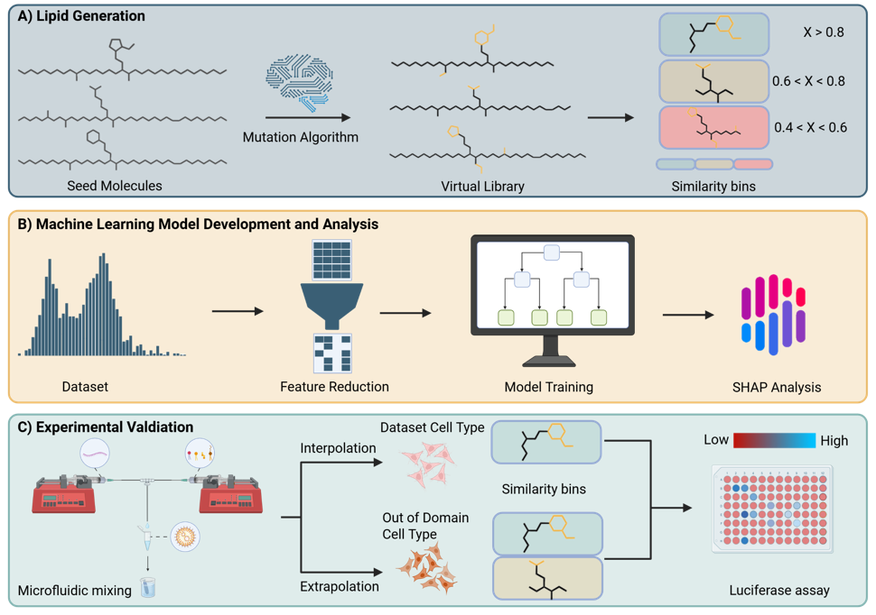
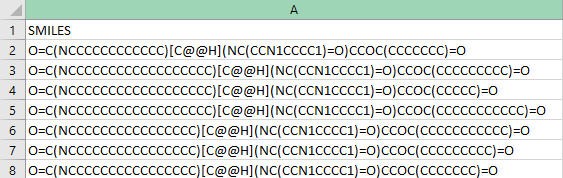

# From-Data-to-Design-Leveraging-AI-for-novel-Lipid-Nanoparticles-for-mRNA-delivery
A Python-based platform for data-driven discovery of ionizable lipids in lipid nanoparticle (LNP) formulations

# Description
This repository contains all code used in our study.

- Abstract
- Requirements
- Installation guide
- Usage
- Inputrequirements and Tips
- How to cite
- License

# Abstract
Designing novel molecules is a complex task traditionally performed by experts in the field. One such challenge is the design of new ionizable lipids for lipid nanoparticles (LNPs) to deliver mRNA therapeutics. Machine learning offers a promising approach to assist chemists in prioritizing which molecules to synthesize, thereby reducing the time- and resource-consuming process of generating and testing large libraries of candidates. Here, we developed an explainable XGBoost classifier to predict whether ionizable lipids will be effective for mRNA delivery. By incorporating feature-importance analysis and SHAP values, our model provides insight into the molecular properties most critical for performance, guiding rational design choices. We evaluated two strategies: (1) screening expert-designed lipids and (2) generating candidates via the STONED algorithm (Aspuru-Guzik et al.) followed by ML evaluation. In both HeLa and lung epithelial cell assays, our model achieved high predictive accuracy and outperformed the FDA-approved lipid MC3. These results demonstrate that ML-assisted design of ionizable lipids can accelerate innovation in RNA therapeutic development by enabling rapid, virtual screening of promising candidates.



# Requirements
The code base uses Python 3.10 and primarily depends on:

- Boruta==0.4.3
- mordredcommunity==2.0.5
- rdkit==2022.9.5
- scikit-learn==1.5.2
- selfies==2.1.1
- xgboost==2.0.3

for a more detailed list few the requirements.txt file

The code base was tested on Windows 10 Enterprise version 22H2

# Installation guide
Before starting, ensure you have Anaconda and Git installed on your system.

1. **Clone the repository**  
````
git clone https://github.com/Fabian-Link/From-Data-to-Design-Leveraging-AI-for-novel-Lipid-Nanoparticles-for-mRNA-delivery/tree/main 
````

2. **Navigate to the cloned directory**
````
cd <directory path>
````

3. **Create a virtual enviroment**
````
conda create --name <enviroment name> python=3.10
````

4. **Activate the virtual enviroment**
````
conda activate <enviroment name>
````

5. **Install dependencys**
````
pip install -r requirements.txt
````

# Usage
1. **Prepare your input file**

- Format: .csv or .xlsx

- Must contain a column named SMILES with the ionizable-lipid SMILES strings.

- Example input file:



2. **Point the predictor to your file**

Open Classifier/prediction.py and change the input path at the top:
````
# File to predict on (CSV or XLSX)
smiles_excel_path = repo_root / "Predictions" / "Extrapolation" / "Homoserine_smiles.xlsx"
````
Replace with your file path (relative to repo root or absolute)

3. **Run**
````
python Classifier/prediction.py
````

4. **Output**
- A prediction file is written next to your input file.
- File name: <your_input_name>_predictions.csv
- with the following columns:
    - SMILES
    - pred_prob (classifier probability for assigned class)
    - pred_label (1 corresponds to the working class and 0 to the none working class)

# Input requirements & Tips
- Valid SMILES only. Invalid/uncanonicalizable SMILES will be reported and skipped.
- No headers other than SMILES are required. Additional columns are allowed.
- The model was trained on a specific experimental setup and cell line; predictions are most reliable within the training domain (see paper for domain and cell-line notes).

# How to cite
coming soon

# License
All code is under MIT license